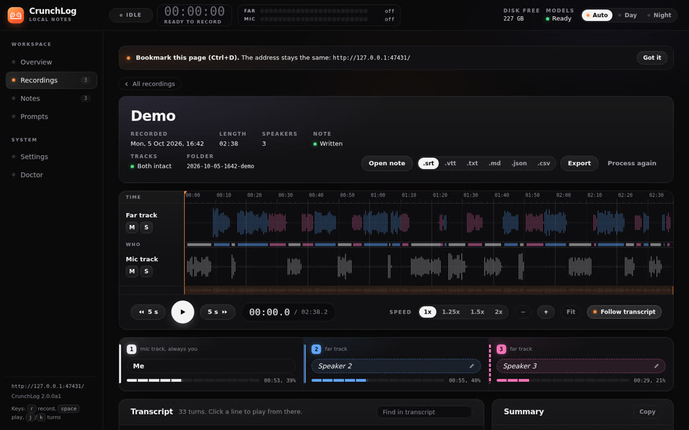

# CrunchLog: guía completa de uso (Windows, macOS y Linux)

[](https://inematds.github.io/crunchlog/guia/es/)

**🇧🇷 [Português](README.md) · 🇺🇸 [English](README.en.md) · 🇪🇸 [Español](README.es.md)**

## 📖 Guía de uso

Guía completa (landing + paso a paso): **https://inematds.github.io/crunchlog/guia/es/**

**CrunchLog** graba reuniones y genera notas en Markdown **sin salir de tu equipo**. Pulsas una tecla cuando empieza la llamada y otra vez cuando termina. Unos segundos después aparece una nota con cada intervención marcada por persona ("Me" eres tú, "Speaker 2", "Speaker 3"... son los demás). No entra ningún bot en la llamada, no necesita cuenta ni clave de API.

- Autor: **Christian Landsteiner**. Versión probada aquí: **2.0.0a1** (build `1daf268`, 04/10/2026).
- Origen: post en la comunidad *AI Automations by Jack* (Skool), [CrunchLog: live meeting co-pilot + fully local private mode for Claude Code, Codex and Agentic OS](https://www.skool.com/aiautomationsbyjack/crunchlog-live-meeting-co-pilot-fully-local-private-mode-for-claude-code-codex-and-agentic-os-windows-mac?p=e0359d6f). El zip está adjunto allí, solo para miembros.
- La integración con **Claude OS** es de **Jack Roberts** ([clase del Agentic OS](https://www.skool.com/aiautomationsbyjack/classroom/af686ad3?md=16da0f0bc87b4d399eadd0b1e69aabc5), solo para miembros). La licencia de CrunchLog exige mantener ese crédito.

> **Este repositorio no contiene CrunchLog.** La licencia es de evaluación y prohíbe redistribuir el software (mira [Licencia](#licencia)). Aquí solo están esta guía, escrita por nosotros, y los scripts propios para Linux en [`linux/`](linux/). Para usarlo, descarga el zip en el post de Skool.

---

## Índice

1. [Qué hace](#1-qué-hace)
2. [Cómo funciona por dentro](#2-cómo-funciona-por-dentro)
3. [Requisitos](#3-requisitos)
4. [Instalar en Windows o macOS](#4-instalar-en-windows-o-macos)
5. [Instalar en Linux (probado)](#5-instalar-en-linux-probado)
6. [Primera nota: el demo](#6-primera-nota-el-demo)
7. [Grabar una reunión de verdad](#7-grabar-una-reunión-de-verdad)
8. [Cómo queda la nota](#8-cómo-queda-la-nota)
9. [Resumen y preguntas con Claude o Codex](#9-resumen-y-preguntas-con-claude-o-codex)
10. [Dashboard en el navegador](#10-dashboard-en-el-navegador)
11. [Hoja de apoyo antes de la reunión (`prep`)](#11-hoja-de-apoyo-antes-de-la-reunión-prep)
12. [MCP: preguntar por las reuniones dentro de Claude Code](#12-mcp-preguntar-por-las-reuniones-dentro-de-claude-code)
13. [Claude OS / Agentic OS](#13-claude-os--agentic-os)
14. [Modo Live (alpha)](#14-modo-live-alpha)
15. [Todos los comandos](#15-todos-los-comandos)
16. [Configuración](#16-configuración)
17. [Privacidad: qué sale del equipo](#17-privacidad-qué-sale-del-equipo)
18. [Problemas y soluciones](#18-problemas-y-soluciones)
19. [Actualizar y desinstalar](#19-actualizar-y-desinstalar)
20. [Licencia](#licencia)

---

## 1. Qué hace

| Función | Cómo es | Estado |
|---|---|---|
| **Dos pistas sin driver** | Graba lo que sale por los parlantes (el "far": Zoom, Meet, YouTube) separado del micrófono (el "mic"). Así sabe qué palabras son tuyas. No necesita VoiceMeeter ni BlackHole. | estable |
| **Una tecla** | `crunchlog toggle` enciende y apaga. Se puede asignar a un atajo, al Stream Deck o al dashboard. | estable |
| **Nota en Markdown** | En la carpeta de notas (funciona bien con Obsidian), con cada intervención marcada y tiempo `[mm:ss]`. | estable |
| **Transcripción local** | Parakeet TDT 0.6B v2 (NVIDIA, int8, ONNX) en la CPU. Medido aquí: **27,6× el tiempo real** (1 h de llamada en ~2 min). | estable |
| **Separación de hablantes** | pyannote segmentation 3.0 + TitaNet (sherpa-onnx) en la pista "far". | estable |
| **Resumen e ítems de acción** | Con tu sesión de **Claude Code** o de **Codex** (suscripción, sin API de pago). | experimental |
| **Preguntar a la reunión** (`ask`) | Las respuestas citan `[mm:ss Hablante]`. | experimental |
| **Hoja de apoyo** (`prep`) | Reúne pendientes, decisiones y preguntas abiertas de las últimas notas de un cliente. Sin modelo. | experimental |
| **Servidor MCP** | Claude Code / Codex / Claude Desktop leen y buscan tus reuniones e inician grabaciones. | experimental |
| **Dashboard** | Grabador, forma de onda, transcripción clicable, renombrar hablantes, prompts, configuración, doctor. | experimental |
| **Live co-pilot** | Transcripción en vivo con AssemblyAI (tu cuenta) y resumen durante la llamada. **Desactivado por defecto.** | alpha |

Límites de esta versión: **solo inglés**, la primera configuración descarga **~700 MB** de modelos, y en macOS exige **14.2+ en Apple Silicon**. Todo lo que va más allá de grabar y generar la nota es experimental.

## 2. Cómo funciona por dentro

```
 tecla / dashboard / MCP
          │
          ▼
  ┌──────────────── grabación (Windows: WASAPI · macOS: CoreAudio · Linux: nuestro pw-record) ┐
  │  far.wav  ← lo que oyes            mic.wav ← lo que dices         meta.json (reloj)       │
  └──────────────────────────────── = 1 "bundle" (una carpeta por reunión) ──────────────────┘
          │
          ▼  crunchlog process  (todo local, CPU)
  VAD (silero) → ASR (Parakeet) por pista → "gate" quita del mic el sonido que se coló de los parlantes
          → separación de hablantes en el far → intervenciones (turns.json) → limpieza ("um", "uh", glosario)
          │
          ├──► nota Markdown en la carpeta de notas  (~/CrunchLog/notes/AAAA-MM-DD-HHMM-slug.md)
          └──► opcional: resumen / ask con `claude -p` o `codex` (tu suscripción)
```

El "truco de las dos pistas": como el micrófono se graba por separado, todo lo que viene de él eres **tú** ("Me"). La separación por IA solo tiene que distinguir a las personas del otro lado. Si el sonido de los parlantes se cuela en el micrófono, el *gate* compara las pistas y descarta del mic las palabras que eran eco (en el demo fueron 262 de 396 palabras descartadas, que eran justamente el eco simulado).

## 3. Requisitos

| | Windows | macOS | Linux |
|---|---|---|---|
| Sistema | 10 u 11 | 14.2+ Apple Silicon | **no soportado oficialmente**; funciona con los scripts de este repo (probado en Ubuntu aarch64 con PipeWire) |
| Grabar | WASAPI, nativo | helper `crunchlog-audio` (viene listo en el zip) | `pw-record` (PipeWire) con nuestro `crunchlog-linux` |
| Demo con voz | System.Speech | `say` | Piper (instalado por nuestro script) |
| Siempre | [uv](https://docs.astral.sh/uv/) (descarga Python 3.12 por sí solo), ~1 GB libre para modelos | | |
| Opcional | `ffmpeg` (importar mp3/mp4), Claude Code o Codex con sesión iniciada (resumen/ask) | | |

Instalar uv:

```powershell
# Windows (PowerShell)
powershell -ExecutionPolicy ByPass -c "irm https://astral.sh/uv/install.ps1 | iex"
```
```bash
# macOS / Linux
curl -LsSf https://astral.sh/uv/install.sh | sh
```

## 4. Instalar en Windows o macOS

1. Descarga `crunchlog-2.0.0a1.zip` en el post de Skool y descomprímelo.
2. **Camino más fácil (lo recomienda el autor):** abre una terminal en la carpeta, ejecuta `claude` y pega:

   ```
   I have extracted CrunchLog into this folder. Read START-HERE.md and AGENTS.md and install it for me, then run the demo so I get my first note.
   ```

   Claude Code sigue el `AGENTS.md` del zip: revisa uv y Python, instala, hace cuatro preguntas (carpeta de notas, dispositivo "far", micrófono, proveedor de resumen), ejecuta el `doctor` y termina con el `demo`.
3. **Camino manual (cuatro comandos, dentro de la carpeta descomprimida):**

   ```bash
   uv tool install --python 3.12 ".[mcp]"
   crunchlog setup        # Enter acepta los valores por defecto; --yes no pregunta nada
   crunchlog doctor       # exit 0 y ninguna línea [fail] = puedes grabar
   crunchlog demo         # tu primera nota en ~1 min
   ```

- `".[mcp]"` ya incluye el servidor MCP. Para el ícono en la bandeja: `".[mcp,tray]"`.
- Si no se encuentra `crunchlog`: `uv tool update-shell` y abre otra terminal (o usa `uv tool run crunchlog ...`).
- **macOS:** la primera grabación pide dos permisos para `crunchlog-audio` (no para la Terminal): **Micrófono** y **Grabación de pantalla y audio del sistema**. Sin el segundo, la pista far sale muda. Si Gatekeeper bloquea el helper, ejecuta `xattr -cr .` **solo en la carpeta descomprimida**.

## 5. Instalar en Linux (probado)

CrunchLog 2.0.0a1 no graba en Linux (`crunchlog devices` → *no recorder backend for this platform*), pero **todo lo demás corre**: transcripción, separación de hablantes, nota, resumen, ask, export, prep, dashboard y MCP. Lo probamos en **Ubuntu, ARM64 (aarch64), PipeWire**, y las dependencias se instalaron sin ningún parche. Para cubrir las dos lagunas (grabar y demo), este repo trae [`linux/`](linux/):

| Archivo | Para qué sirve |
|---|---|
| `linux/recorder_linux.py` | Grabador de dos pistas con `pw-record`: monitor de la salida predeterminada → `far.wav`, entrada predeterminada → `mic.wav`, `meta.json` según el contrato oficial (`bundle_version: 2`). Al hacer `stop`, llama al pipeline oficial. |
| `linux/demo_linux.py` | El mismo `crunchlog demo` (mismo guion, mismo montaje, mismo pipeline), solo cambiando la voz del sistema por **Piper**. No modifica el código de CrunchLog. |
| `linux/crunchlog-linux` | Atajo: `demo`, `start`, `stop`, `toggle`, `status`, `devices`. |
| `linux/instalar-extras-linux.sh` | Instala Piper + 3 voces en inglés (~190 MB) y pone `crunchlog-linux` en `~/.local/bin`. |

Paso a paso (exactamente lo que ejecutamos):

```bash
# 1. CrunchLog (dentro de la carpeta descomprimida del zip)
uv tool install --python 3.12 ".[mcp]"
crunchlog --version          # crunchlog 2.0.0a1 (build 1daf268 of 2026-10-04)

# 2. Setup sin preguntas (en Linux no hay lista de dispositivos para elegir)
crunchlog setup --yes --provider none      # descarga los ~700 MB de modelos

# 3. Extras de este repo
git clone https://github.com/inematds/crunchlog && bash crunchlog/linux/instalar-extras-linux.sh

# 4. Comprobar
crunchlog doctor
```

Salida real del `doctor` en Linux: las dos líneas `[fail]` son solo de la grabación nativa, que `crunchlog-linux` reemplaza.

```
[fail] platform: linux: CrunchLog records on Windows and macOS only
[ok  ] python: Python 3.12.3
[ok  ] sherpa-onnx: bundled onnxruntime not needed on this platform
[ok  ] config: /home/<tú>/.config/crunchlog/config.toml
[fail] devices: UnsupportedPlatform: CrunchLog records on Windows and macOS; this is linux
[ok  ] models: /home/<tú>/.cache/crunchlog/models
[ok  ] summary: provider none; on PATH: claude, codex
[ok  ] ffmpeg: /usr/bin/ffmpeg
[ok  ] asr speed: 27.6x realtime (a 1-hour call takes about 2 min)
[ok  ] disk: 211.9 GB free at /home/<tú>/CrunchLog
Recording cannot start: fix platform, devices.
```

Elegir otras tarjetas de sonido: `wpctl status` lista los dispositivos y `wpctl inspect <id> | grep node.name` muestra el nombre. Después basta con usar `CRUNCHLOG_FAR_TARGET=<sink>` y `CRUNCHLOG_MIC_TARGET=<source>` antes de `crunchlog-linux start`.

## 6. Primera nota: el demo

El demo representa una reunión inventada con tres personas ("Me" en el micrófono; Dana y Lee del otro lado), graba las dos pistas con una fuga de parlantes simulada, procesa todo en el pipeline real e imprime la ruta de la nota. No necesita micrófono.

```bash
crunchlog demo            # Windows / macOS
crunchlog-linux demo      # Linux
```

Salida real en Linux:

```
synthesising 33 lines
voices: Me: en_GB-alan-medium; Dana: en_US-amy-medium; Lee: en_US-ryan-medium
wrote 2026-10-05-1642-demo: 158.3 s per track
asr far: 261 words in 9.124 s
asr mic: 396 words in 11.478 s
gate: kept 134 mic words, dropped 262 (margin 3.0 dB)
diarize: 22 spans, 2 far speakers (asked for 2) in 6.218 s
turns: 33 turns, talk seconds per role {'Me': 53.8, 'Speaker 2': 55.5, 'Speaker 3': 29.0}
done in 57 s
note: /home/<tú>/CrunchLog/notes/2026-10-05-1642-demo.md
```

Opciones: `--no-process` (solo graba el bundle), `--voices A,B,C`, `--list-voices`, `--no-bleed` (sin fuga simulada).

## 7. Grabar una reunión de verdad

```bash
crunchlog toggle                 # empieza (Windows/macOS)
# ... reunión ...
crunchlog toggle                 # se detiene; la nota sale en unos segundos

crunchlog-linux toggle           # lo mismo en Linux
crunchlog start --slug acme --speakers 3   # nombre en la carpeta + total de personas (incluyéndote)
crunchlog status                 # idle / recording
```

**Asignarlo a una tecla:**
- **Windows:** PowerToys Keyboard Manager o AutoHotkey ejecutando `crunchlogw toggle` (`crunchlogw` no abre ventana de consola). Stream Deck: acción "System: Open" → `crunchlog.exe toggle`.
- **macOS:** atajo de la app Atajos con "Ejecutar script de shell" `crunchlog toggle`, o Raycast / Hammerspoon.
- **Linux:** atajo personalizado de GNOME/KDE que apunte a `~/.local/bin/crunchlog-linux toggle`.
- **Bandeja con atajo global** (Windows/macOS): instala con `".[mcp,tray]"` y ejecuta `crunchlog tray --hotkey ...`.

Antes de la primera llamada, `crunchlog check-audio --tone` graba unos segundos y dice si las dos pistas están escuchando (Windows/macOS).

**Archivos que ya tienes** (mp3, m4a, mp4, wav): `crunchlog process archivo.mp4`. Todo entra como pista "far", así que no hay "Me" y los hablantes empiezan en Speaker 2. Una carpeta vigilada: `crunchlog watch ~/Grabadora`. Lo probamos con el video de walkthrough del autor (2:26): **nota lista en 18 s**.

## 8. Cómo queda la nota

Archivo `~/CrunchLog/notes/2026-10-05-1642-demo.md` (reunión inventada del demo):

```markdown
---
date: 2026-10-05
start: 16:42
duration: 02:38
speakers: 3
asr_model: nemo-parakeet-tdt-0.6b-v2:int8
diarization_model: sherpa-onnx:pyannote-segmentation-3.0+nemo_en_titanet_small
---

# Meeting 2026-10-05 16:42

## Summary            ← solo con proveedor claude/codex
## Decisions
- The beta starts on November 12 with 200 testers and opens to everyone else two weeks later.
## Action items
- [ ] Speaker 3: Fix the sync crash on older tablets ..., by next Wednesday.
- [ ] Speaker 2: Write a draft invite email for the first 200 testers ..., by Friday.
## Open questions
- Do we charge for the premium tier during the beta ...?

## Transcript
[00:00] Me: Okay, let's get started. Thanks for joining Dana and Lee. ...
[00:09] Speaker 2: Sounds good. I have the numbers from the last test round ...
[00:27] Speaker 3: Most of what is left is the same crash on older tablets. ...
```

Junto a ella, en la carpeta de la grabación (`~/CrunchLog/recordings/<nombre>/`), quedan `far.wav`, `mic.wav`, `meta.json`, `words.json`, `turns.json`, `summary.md`, `pipeline.log`.

Después de grabar:

```bash
crunchlog speakers <grabación> "Speaker 2=Dana" "Speaker 3=Lee"   # pone nombres y rehace la nota
crunchlog note "el cliente quiere la propuesta para el viernes"     # tus anotaciones entran en el resumen
crunchlog export ~/CrunchLog/recordings/<grabación> --format srt    # srt|vtt|txt|json|csv|md
crunchlog open latest --obsidian
crunchlog rerender <grabación>                                      # rehace la nota sin transcribir de nuevo
```

## 9. Resumen y preguntas con Claude o Codex

El resumen no usa API de pago: CrunchLog llama a **tu CLI con sesión iniciada** (`claude -p ...` o `codex`) con herramientas, MCP y comandos desactivados, es decir, sale de tu suscripción.

```toml
# ~/.config/crunchlog/config.toml
[summary]
provider = "claude"        # none | claude | codex | auto
claude_model = "opus"      # opus | sonnet | haiku
claude_effort = "medium"
```

Medido aquí: resumen del demo con Claude en **10,3 s** (1.285 caracteres: Summary, Decisions, Action items, Open questions).

```bash
crunchlog ask latest "What was decided about the beta launch date and size?"
```

Respuesta real (con citas clicables en el dashboard):

> The beta starts on **November 12 with 200 testers**, and it opens to everyone else two weeks later [01:13 Me]. ... Me thought 500 was too many with a crash the team already knew about [00:49 Me].

Plantillas de resumen por tipo de reunión: `crunchlog templates list | use standup | which` (standup, sales call, interview...). Los prompts se pueden editar en la página **Prompts** del dashboard.

## 10. Dashboard en el navegador

```bash
crunchlog dashboard            # http://127.0.0.1:47431/ (solo local; --port lo cambia; --no-browser no lo abre)
```

En la primera visita de cada navegador, usa el enlace con `?t=...` que imprime (es el inicio de sesión local) y después guarda la dirección simple en favoritos.

| Página | Qué tiene |
|---|---|
| **Overview** | Botón Record/Stop, medidores de las dos pistas, título, número de hablantes, últimas grabaciones, disco y modelos |
| **Recordings** | Archivo de grabaciones, filtros (sin procesar, con problema), calendario |
| **Grabación** | Forma de onda de las dos pistas, quién habla y cuándo, reproductor (1×–2×), transcripción clicable, renombrar hablantes, resumen, export, "Process again" |
| **Notes** | Todas las notas de la carpeta |
| **Prompts** | Plantillas de resumen; cuál está en uso |
| **Settings** | Carpetas, dispositivos, transcripción, etiquetas de hablantes, limpieza, resumen (Opus medio con tu suscripción), ask, live, notificaciones |
| **Doctor** | Las mismas comprobaciones de `crunchlog doctor` y el botón "Update now" |

En Linux, el botón **Record** del dashboard no funciona (usa el grabador nativo). Graba con `crunchlog-linux`, y el dashboard muestra y reproduce la grabación con normalidad.



## 11. Hoja de apoyo antes de la reunión (`prep`)

```bash
crunchlog prep "acme"                     # reúne las notas de los últimos 90 días con "acme" en el título/participantes
crunchlog prep "acme" --calendar "Jue 14h, Ana y Bruno" --dry-run
```

Genera `<notas>/AAAA-MM-DD-acme-cheatsheet.md` con ítems de acción abiertos, decisiones anteriores, preguntas abiertas y de 3 a 5 preguntas guía `(qN)`. No llama a ningún modelo. Con `[prep] enabled = true`, cuando la próxima nota de Acme queda lista, **marca solo** las preguntas que fueron respondidas. Los enlaces por cliente quedan en `~/.config/crunchlog/links/acme.md`.

## 12. MCP: preguntar por las reuniones dentro de Claude Code

```bash
claude mcp add crunchlog -- crunchlog mcp
```

Después basta con preguntar en Claude Code: *"¿qué acordamos con Acme el martes?"* o *"empieza a grabar la reunión"*. Probamos el servidor por stdio, y responde con **15 herramientas**:

`status`, `list_recordings`, `get_transcript`, `get_note`, `get_summary`, `search_notes`, `prep`, `cheatsheet`, `start_recording`, `stop_recording`, `toggle_recording`, `process`, `rename_speakers`, `export`, `doctor`.

En Codex y en Claude Desktop, registra el mismo comando `crunchlog mcp` (stdio). El zip también trae un **plugin de Claude Code** (`plugins/crunchlog`) con skills de briefing e ítems de acción: copia la carpeta a un lugar fijo y ejecuta `claude plugin marketplace add ./crunchlog` y `claude plugin install crunchlog@crunchlog`.

Atención: lo que el cliente MCP lee de las notas va al proveedor de su modelo (Anthropic, OpenAI), como en cualquier sesión.

## 13. Claude OS / Agentic OS

Si usas el **Claude OS de Jack Roberts** ([clase del Agentic OS](https://www.skool.com/aiautomationsbyjack/classroom/af686ad3?md=16da0f0bc87b4d399eadd0b1e69aabc5), solo para miembros):

```bash
crunchlog connect agentic-os --dry-run    # muestra lo que va a hacer
crunchlog connect agentic-os              # registra el MCP en Claude Code + crea ~/Documents/Obsidian/CrunchLog/
crunchlog connect agentic-os --status | --undo
```

A partir de ahí, cada nota nueva se copia a esa bóveda, aparece en la página **Memory** de Claude OS y cualquier sesión de Claude Code puede buscarla. (No ejecutamos este comando, porque modifica el registro MCP de Claude Code.)

## 14. Modo Live (alpha)

Desactivado por defecto. Cuando se activa, transmite **las dos pistas a AssemblyAI** (con tu clave y en tu cuenta, que es de pago) y envía las intervenciones y preguntas a tu Claude/Codex. Durante la llamada aparecen: la hoja de apoyo marcando las preguntas respondidas, resúmenes por bloque que se pliegan, la última pregunta fijada y un "pregúntale a la reunión". **La nota final sigue saliendo del pipeline local.** No lo actives en llamadas confidenciales.

```toml
[live]
enabled = true
provider = "assemblyai"
api_key = "..."     # tu clave; nunca la compartas
```

## 15. Todos los comandos

| Comando | Para qué sirve |
|---|---|
| `toggle [--no-process]` | Enciende/apaga la grabación (el de la tecla) |
| `start [--slug X] [--speakers N]` / `stop [--no-process]` / `status [--json]` | Control manual |
| `process <carpeta-o-archivo> [--speakers N]` | Procesa un bundle de nuevo o importa audio/video |
| `devices` / `check-audio [--tone]` | Dispositivos y prueba de 2 pistas |
| `setup [--yes] [--notes P] [--far N] [--mic N] [--provider X]` | Primera configuración + modelos |
| `doctor [--skip-benchmark] [--json]` | Comprobación completa (exit 0 = ok) |
| `init-config` / `config-path` | Config predeterminada / dónde está |
| `demo [--no-process] [--voices A,B,C]` | Reunión inventada → nota |
| `dashboard [--port N] [--no-browser]` | Panel web local |
| `mcp` | Servidor MCP (stdio) |
| `ask <grabación\|latest> "pregunta" [--follow-up]` | Pregunta a la reunión |
| `note "texto"` | Tus anotaciones de la grabación actual |
| `templates list\|use\|which` | Plantilla de resumen por tipo de reunión |
| `speakers <grabación> "Speaker 2=Nombre"` / `rerender` / `open` | Posprocesamiento de la nota |
| `export <carpeta> --format srt\|vtt\|txt\|json\|csv\|md` | Exportar |
| `prep "cliente"` | Hoja de apoyo previa a la reunión |
| `watch <carpeta>` / `watch-meetings` | Procesa lo que caiga en una carpeta / avisa cuando empieza una llamada |
| `tray [--hotkey K]` | Ícono en la bandeja (extra `tray`) |
| `connect agentic-os` | Conecta con Claude OS |
| `live tail` / `live summarise` | Modo live (alpha) |
| `update [zip] [--check]` | Actualiza a partir del zip en la carpeta Descargas |

Linux (de este repo): `crunchlog-linux demo | start | stop | toggle | status | devices`.

## 16. Configuración

Archivo: `~/.config/crunchlog/config.toml` (o `$CRUNCHLOG_CONFIG`, o `--config`). Los campos principales:

```toml
[paths]
recordings = "~/CrunchLog/recordings"
notes = "~/CrunchLog/notes"          # puede ser una carpeta dentro de la bóveda de Obsidian
models = "~/.cache/crunchlog/models"

[audio]
far_device = ""                      # vacío = predeterminado del sistema
mic_device = ""

[asr]
model = "nemo-parakeet-tdt-0.6b-v2"  # inglés
quantization = "int8"                # o "none" (fp32, 4x RAM)

[diarization]
far_track = true
max_speakers = 0                     # 0 = automático

[speakers]
me_label = "Me"
them_label = "Speaker"

[gate]
enabled = true
margin_db = 3.0                      # súbelo si tu mic capta mucho eco de los parlantes

[cleanup]
fillers = ["um", "umm", "uhm", "uh", "uhh"]
glossary = "~/.config/crunchlog/glossary.txt"   # "Quillery => Quillory", uno por línea

[summary]
provider = "none"                    # none | claude | codex | auto
template = "~/.config/crunchlog/summary-prompt.md"

[dashboard]
port = 47431

[prep]
enabled = false
```

Consejo: el glosario corrige nombres que el ASR siempre se equivoca (en el demo, "Quillory" salió como "Quillery").

## 17. Privacidad: qué sale del equipo

- **Audio y carpetas de grabación: nunca salen.** Grabar y transcribir no abre ninguna conexión.
- **El texto de la reunión sale solo** si usas resumen o `ask` (va a Anthropic/OpenAI por tu CLI), un cliente MCP, o el modo Live (en ese caso el audio va a AssemblyAI).
- **Descargas:** solo los modelos, una vez (Hugging Face y releases de sherpa-onnx en GitHub).
- **Modo totalmente privado:** `provider = "none"` y `[live] enabled = false`.

## 18. Problemas y soluciones

| Síntoma | Causa / solución |
|---|---|
| `crunchlog: command not found` | `uv tool update-shell` y abre otra terminal, o usa `uv tool run crunchlog ...` |
| Pista far muda (macOS) | Falta el permiso "Grabación de pantalla y audio del sistema" para `crunchlog-audio`. Concédelo y graba de nuevo |
| Procesar falla, grabar funciona (Windows) | `doctor` muestra `sherpa-onnx ... bundled onnxruntime missing`. Ejecuta `uv tool install --python 3.12 --reinstall ".[mcp]"` en la carpeta del zip |
| `Access is denied` al reinstalar (Windows) | Cierra el tray y el dashboard antes |
| Hablantes unidos en uno solo | `crunchlog process <carpeta> --speakers N` (N te cuenta a ti) |
| Puerto 47431 ocupado | `crunchlog dashboard --port 47500` o `[dashboard] port` |
| **Linux:** `no recorder backend for this platform` | Es lo esperado. Usa `crunchlog-linux start/stop/toggle` |
| **Linux:** `crunchlog demo` dice que solo habla en Windows/macOS | Usa `crunchlog-linux demo` (Piper) |
| **Linux:** far vacío | Comprueba con `crunchlog-linux devices`; si el sonido sale por otra tarjeta, usa `CRUNCHLOG_FAR_TARGET=<node.name>` |
| **Linux:** mic sin palabras en una sesión remota (RDP) | La entrada de RDP no tiene micrófono; usa una entrada real con `CRUNCHLOG_MIC_TARGET` |
| Nota de archivo importado sin "Me" | Es normal: un archivo único se convierte solo en pista far |

Los problemas de macOS están detallados en `docs/mac-helper.md` dentro del zip, y los del demo en `docs/features/demo.md`.

## 19. Actualizar y desinstalar

- **Actualizar:** descarga el zip nuevo en la carpeta Descargas y haz clic en **Update CrunchLog** (bandeja), en **Update now** (Doctor del dashboard) o ejecuta `crunchlog update`. La config, las grabaciones, las notas y el inicio de sesión del dashboard se conservan. En las primeras versiones, sin el comando `update`, cierra todo y ejecuta `uv tool install --python 3.12 --reinstall ".[mcp]"` en la carpeta nueva.
- **Desinstalar:** `uv tool uninstall crunchlog`, después borra `~/.cache/crunchlog` (modelos) y `~/.config/crunchlog` (config). Tus grabaciones y notas se quedan donde están. Los extras de Linux se quitan con `uv tool uninstall piper-tts` y `rm ~/.local/bin/crunchlog-linux`.

---

## Licencia

**CrunchLog** es © 2026 Christian Landsteiner, bajo la **CrunchLog Evaluation Licence**. Permite descargar, instalar y usar en tus equipos para uso personal y evaluación, además de leer y modificar el código para ese fin. **Prohíbe** redistribuir (incluso en un repositorio público), vender u ofrecer como servicio, y quitar el crédito a Claude OS de Jack Roberts. Por eso este repositorio **no** contiene el zip, el código ni los videos del autor. Contacto para otros usos: el correo que aparece en el `LICENSE` dentro del zip.

El contenido de este repositorio (esta guía, la guía en `guia/` y los scripts en `linux/`) es de INEMA. Los scripts de `linux/` solo funcionan con un CrunchLog que tú mismo descargaste e instalaste.
